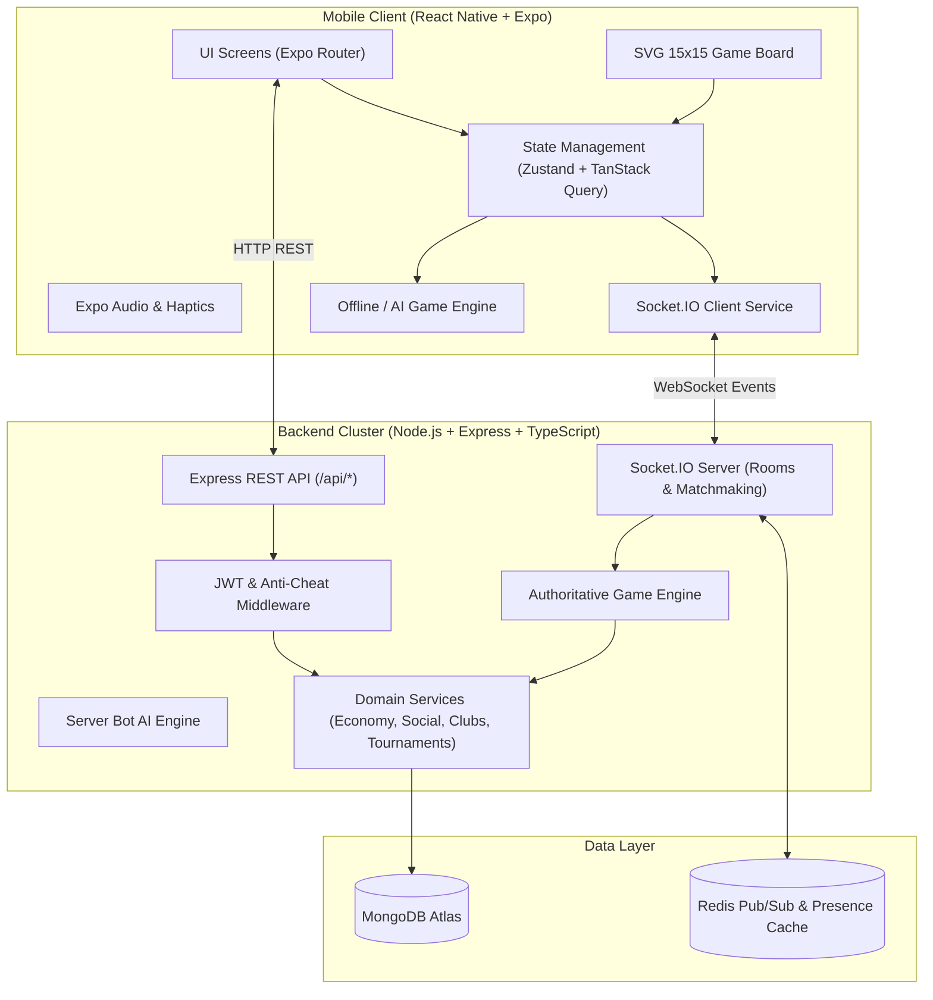

# Royal Ludo - System Architecture

## Architecture Principles
1. **Authoritative Server**: In online multiplayer, client devices never generate dice numbers, compute valid moves, or declare match winners. The server maintains authoritative state.
2. **Shared Deterministic Game Engine**: Game rules and state transitions are written in pure TypeScript in `/shared`, allowing the mobile client (for offline mode) and the Node.js backend (for online mode) to execute the exact same battle-tested engine.
3. **Decoupled Presentation**: The board renderer is completely decoupled from the game state machine. The state machine emits snapshot updates, and the UI animates tokens and dice accordingly.
4. **Resilient Reconnection**: If a player disconnects, the server marks them as reconnecting, gives an automatic 30-second grace timer (or triggers an intelligent bot surrogate), and permits seamless resynchronization of the exact game snapshot on reconnect.
